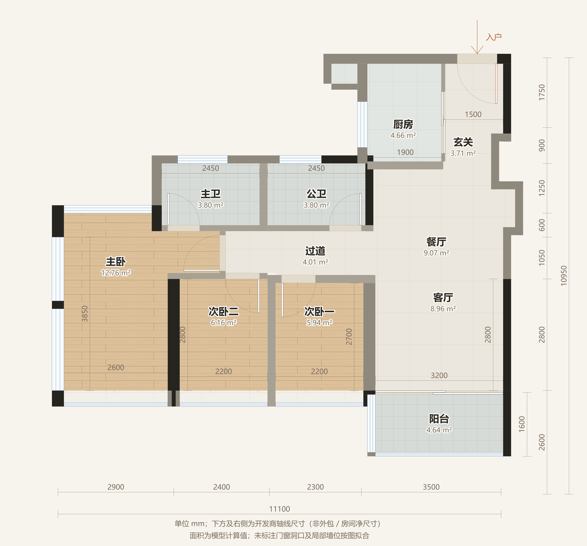
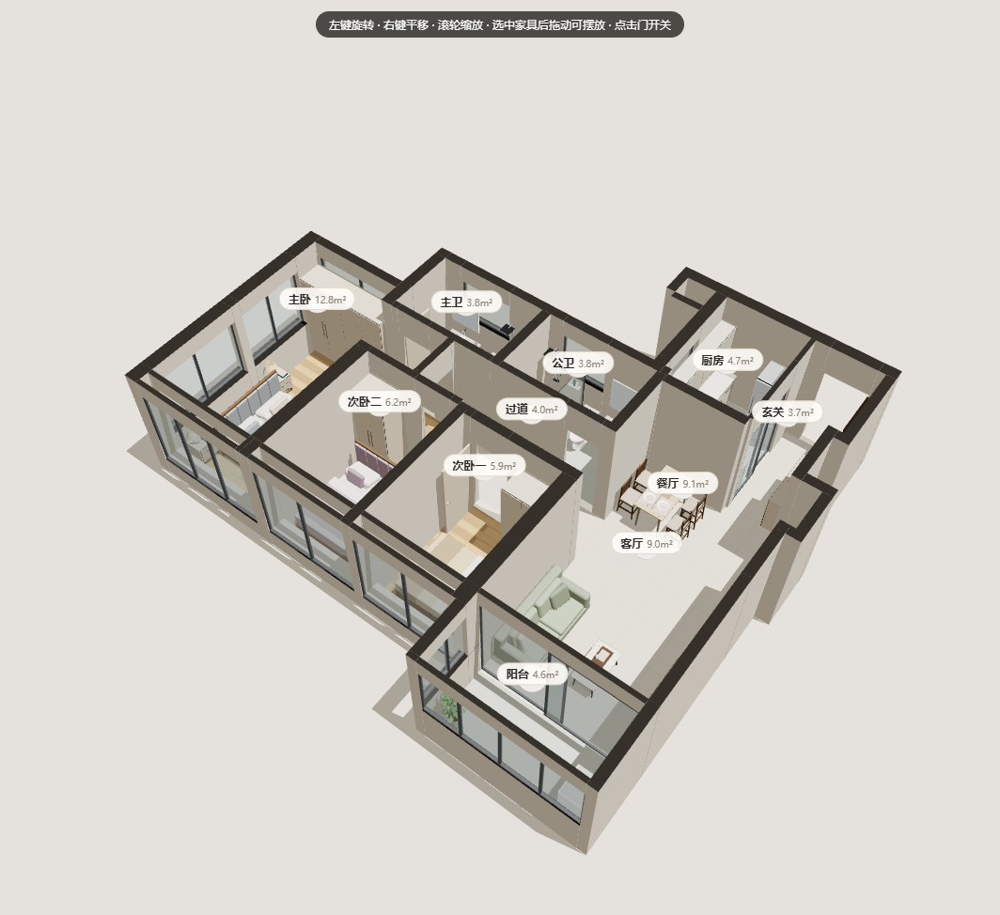

# 77B · 户型工作室

基于 [wy51ai/floorplan-3d](https://github.com/wy51ai/floorplan-3d) 改造的 77B 三室两厅两卫模型。保留 2D 家具编辑、测量、地面材质、3D 鸟瞰与漫游、撤销/重做、本地保存及 PNG/JSON 导出。

发布仓库：[otahj90-cmd/77B](https://github.com/otahj90-cmd/77B)。网站：[77B 户型工作室](https://otahj90-cmd.github.io/77B/)。本文件说明精装复原 v3 的源码；实际上线版本以网站和仓库部署记录为准。

与参照站对应的操作包括：尺寸、房间、家具、网格、承重墙参考、贴墙吸附。默认布置示例家具/家电，并按开发商精装照片补充固定构件；家具支持宽深尺寸编辑、拖动、旋转、复制、删除。网格为500/1000mm参考格；家具移动以10mm步进，并可按旋转后的边缘贴墙吸附。黑色图示墙段受保护，可单独高亮；界面称“承重墙参考”，其结构性质仍需开发商结构图确认。

**明确标注的尺寸取用户提供的第一张开发商图；右侧墙体轮廓按用户补充的墙体图修正，精装细节按用户提供的 77B VR 照片复原。** 未标注的转折偏移、装饰高度及柜体分格是拟合或假定值。第三张错误尺寸图未参与建模，源码包也没有包含它。图纸和五张精装照片可在页面的“图纸与尺寸依据”中查看。





## v3 开发商精装复原

厨房灶具移至北侧，水槽位于西侧窗下；南侧原满高隔墙改为石材吧台、地柜及局部深色框磨砂玻璃隔断。吧台上的玻璃与厨房、玄关之间的独立磨砂移门互相垂直，分别建模。玄关增加整墙木饰面收纳和石材壁龛。

两卫保留原有镜像布局：主卫西侧浴室柜、中间马桶、东侧淋浴；公卫西侧淋浴、中间马桶、东侧浴室柜。补充木纹浴室柜、镜柜、玻璃淋浴、石材墙面等饰面；主卫使用灰白小方拼地面，公卫使用浅灰地砖。左侧小卧室按照片标为“儿童房”，右侧标为“次卧”，净尺寸分别仍为 2200×2800 和 2200×2700。

客餐厅、玄关等公共区域采用浅色人字拼地面，卧室采用直铺浅木地板；补充白墙、深色踢脚线、卧室黑色窗框与护栏、石材窗台及吊顶灯带示意。主卧窗分段依据照片拟合，不据此扩大房间或改变开发商明确标注净尺寸。

照片不包含标尺。吧台、吊柜、壁龛、玻璃、护栏、灯槽等的高度、厚度和未标注位置为模型拟合或假定，不能当作开发商交付尺寸。参考链接：[开发商 VR](https://infishow.ideamake.cn/icp/guangzhou-nanzhanwan_19664/yangbanjianhuizong_6.html?showmenu=reset&showparam=scene_keting_86bbkic&showpage=vr_tour&timestamp=1754884477395&read_source=2)，进入后选择 77B。

## 保留的 v2 右侧墙体修订

修复前版把右边画成连续直墙的问题：玄关下部向内收进、餐厅局部向外凸出，再回到客厅与阳台的主墙线。玄关和餐厅地面多边形同步跟随墙线，默认鞋柜向内移动以避开凹口。

以既有主内墙 `x=11150` 为基准，内凹至 `x=10850`、外凸至 `x=11450`，转折位置采用 `y=1900/3300/4250`。这些 **300mm偏移及节点坐标均由参考图拟合，不是开发商标注**。阳台保留第一张开发商图的分界。

## 尺寸与精度

单位均为 mm。原点为开发商图 `9-5 × 9-L` 轴线交点，X 向右、Y 向下。轴线间距与房间净尺寸分开记录。

| 项目 | 图纸标注 |
| --- | --- |
| 横向轴线链 | 2900 + 2400 + 2300 + 3500 = 11100 |
| 纵向轴线链（9-L → 9-A） | 1750 + 900 + 1250 + 600 + 1050 + 2800 + 2600 = 10950 |
| 主卧主体 | 2600 × 3850；北侧衣柜深600，另有入门扩展区 |
| 儿童房（左，原次卧二） | 2200 × 2800 |
| 次卧（右，原次卧一） | 2200 × 2700 |
| 次卧之间隔墙 | 200 |
| 两卫 | 各2450 × 1550 |
| 厨房 / 玄关 | 宽1900 / 1500，合3400；厨房纵深读作2450，小字建议用原CAD复核 |
| 过道 | 局部净深1050 |
| 客厅 | 3200 × 2800 |
| 卧室南飘窗 | 深300 |
| 阳台 | 竖向原标注1600，标线涉及外缘，不称净深 |

房间明确净尺寸优先，未标注的墙面偏移、部分墙厚及门窗洞口按图拟合。这是**按开发商标注复原的可编辑模型**，不是完整CAD逐点测绘。不能把轴线11100当成户型外包宽，也不能把截图推定值当成开发商精确数据。

模型阳台净深1450是扣除拟合边框后的推定值。墙体参考图将客厅南部较大区域画为阳台、最南另画花池，与开发商图不同；模型采用其右侧墙体转折，保留开发商图的客厅与阳台分界。

3D假定：层高2800，门洞2100，窗头2400，普通窗台900、卫浴窗台1100、主卧西南窗及飘窗台450、阳台窗台1050；厨房磨砂移门高2400。门宽、家具、材价和光照均为演示参数。黑色墙段按图示锁定，墙体真实结构性质没有由截图认定。仅允许模拟拆除模型中的普通内隔墙。

所有面积由模型多边形计算。飘窗和图示设备凹槽单列，模型地面净面积不代表开发商公示面积、产权面积或赠送面积。模型未使用第三张图的面积或使用率。

## 本地运行

在此目录运行任一静态HTTP服务器，例如：

```sh
python -m http.server 8000
```

打开 `http://localhost:8000`。Windows也可右键运行 `start-preview.ps1`；该脚本查找已安装的 Python 或 Node，不安装软件。

通过HTTP服务器打开才可以加载浏览器ES模块并使用3D。直接双击 `index.html` 仅适合2D预览。Three.js及其插件已放在 `vendor/`，页面没有远程CDN或API依赖。

## 放到 GitHub Pages

1. 使用 GitHub 账号 `otahj90-cmd` 新建公开仓库 `77B`。
2. 上传**此目录中的内容**至仓库根目录，保留 `vendor/`、`references/` 等子目录；不要只上传HTML，也不要多套一层目录。
3. 在仓库 Settings → Pages 中选择 `Deploy from a branch`，选 `main` 分支和 `/ (root)`，保存。
4. 成功发布后的地址为 `https://otahj90-cmd.github.io/77B/`。

页面使用相对资源路径，可部署在仓库子路径下。无需npm安装、构建、后端或API Key。请以 GitHub Pages 设置和实际在线访问结果确认发布状态。

## 修改源码

| 文件 | 内容 |
| --- | --- |
| `floorplan-data.js` | 全部77B墙体、门窗、房间多边形、参考家具、尺寸链、依据和假定 |
| `geometry-analysis.json` | 原始图纸尺寸追溯、轴线站点、像素标定与不确定项；其中建议坐标是分析记录，实际运行以 `floorplan-data.js` 为准 |
| `index.html` | 原项目2D/3D编辑器，已移除旧户型坐标和旧存储键 |
| `77b-finishes.js` | 厨房石材台面/玻璃、玄关壁龛、卫浴墙砖镜柜、窗栏、灯槽等固定精装细节与程序纹理 |
| `77b-interface.js` / `77b.css` | 图纸及精装照片、尺寸清单、旧版方案备份、数据下载及77B界面样式 |
| `vendor/three/` | Three.js r160及插件，含MIT许可证和来源记录 |
| `references/` | 用户提供的开发商尺寸图、墙体参考图及五张77B精装VR截图 |
| `tools/validate.mjs` | 无第三方依赖的模型一致性检查 |

墙体格式：`[x0,y0,x1,y1,type,可选高度mm]`，`b`为图示锁定段，`e`为外边界，`n`为普通内隔墙，`low`为低墙/台面边界。房间 `poly` 是地面净多边形；`counted:false`只控制面积统计，`elevation`独立控制高台高度。

调整户型数据后需同步相关墙、地面、门窗和尺寸标注。明确尺寸不通过拖拽修改墙体；编辑 `floorplan-data.js` 后刷新页面即可。

```sh
node tools/validate.mjs
```

浏览器功能验证记录见 [VALIDATION.md](VALIDATION.md)。

## 保存与备份

方案保存在当前浏览器当前站点的 `localStorage`，不会自动云同步。建议用“文件 → 导出方案JSON”备份。本版方案带有 `floorplanId: "77B-developer-fitout-v3"`，使用独立存储键 `floorplan-77b-developer-fitout-v3`，不接受其他户型或前版v1/v2的JSON，避免旧墙索引和几何记录污染精装模型。

旧版本浏览器存储保留，不会被删除、迁移或覆盖。如果当前浏览器仍有 v2 存储键 `floorplan-77b-wall-revision-v2`，打开“图纸与尺寸依据”后会出现“导出旧版方案备份”按钮，按原始内容下载旧方案 JSON。该备份不自动导入 v3，旧方案与精装模型分别保存。

“下载完整户型数据JSON”导出的是模型定义和尺寸依据；“导出方案JSON”导出的是家具、地材及测量等编辑状态，两者用途不同。

## 许可与来源

上游项目：[wy51ai/floorplan-3d](https://github.com/wy51ai/floorplan-3d)，MIT，原版权声明保留在 `LICENSE`。

Three.js：[mrdoob/three.js r160](https://github.com/mrdoob/three.js/tree/r160)，MIT，见 `vendor/three/LICENSE`。

本交付的77B适配代码沿用MIT许可。`references/`中的图纸和精装截图是用户提供的参考资料，不因代码许可而新增其授权范围。
